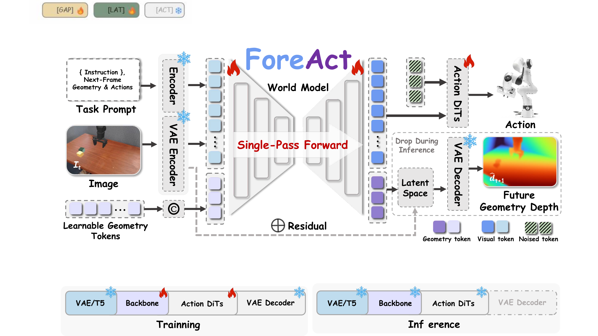

#  Geometry-Guided Action Learning from World Representations

ForeAct is a geometry-aware vision-language-action policy for efficient robot
manipulation. It reuses a pretrained video world model as a single-pass visual
representation backbone and predicts continuous action chunks with a
flow-matching action head. During training, eight learnable geometry tokens are
supervised with next-frame relative depth. The auxiliary geometry decoder provides training-time supervision for the shared
representation.

<p align="center">
  <a href="docs/assets/foreact_pipeline.pdf">
    
  </a>
</p>

## 🧠 Method

Given an RGB observation and a language instruction, ForeAct:

1. encodes the image with a frozen video VAE and the instruction with a frozen
   text encoder;
2. processes visual tokens together with eight learnable geometry tokens in one
   bidirectional world-model pass;
3. conditions an ActionDiT on the resulting visual representation to predict a
   continuous action chunk;
4. decodes the geometry tokens into the next-frame relative depth during
   training only.

The depth branch uses offline MoGe-3 targets. No depth image or external geometry
model is needed at deployment.

## 📊 Results

| Benchmark | Evaluation setting | Success rate |
| --- | --- | ---: |
| LIBERO | 4 suites, 2,000 episodes | 96.55% |
| SimplerEnv-Bridge | 4 tasks, 96 episodes | 63.54% |

The exact evaluation records are stored in [`configs/evaluation/`](configs/evaluation/).
They document the reported runs and are not training configurations.

## 🤗 Checkpoints

| Benchmark | Checkpoint | Download |
| --- | --- | --- |
| SimplerEnv-Bridge | 50K steps | [bridge_step50000](https://huggingface.co/Bulru1234/ForeAct/tree/main/bridge_step50000) |
| LIBERO | 100K steps | [libero_step100000](https://huggingface.co/Bulru1234/ForeAct/tree/main/libero_step100000) |

Both releases include model weights, the training configuration, and dataset
statistics. File checksums are available in
[`SHA256SUMS`](https://huggingface.co/Bulru1234/ForeAct/blob/main/SHA256SUMS).

## 🛠️ Installation

The reference environment uses Python 3.10, PyTorch 2.6.0 and CUDA 12.4.

```bash
conda create -n foreact python=3.10 -y
conda activate foreact

pip install torch==2.6.0 torchvision==0.21.0 \
  --index-url https://download.pytorch.org/whl/cu124
pip install -r requirements.txt
pip install -e .
```

Copy the environment template and replace the example paths with locations on
your machine. The project does not automatically load `.env`; export the values
in the shell or source the file explicitly.

```bash
cp .env.example .env
set -a
source .env
set +a
```

## 📦 Required Assets

ForeAct expects the following resources to remain outside Git:

```text
pretrained/cosmos2/       # Cosmos-Predict2 model
data/                     # LeRobot datasets
data/depth/               # offline MoGe-3 caches
checkpoints/              # trained policy weights
outputs/                  # training and evaluation outputs
```

The active data contracts are:

- Bridge: `bridge_orig_1.0.0_lerobot` with a main-camera `t+1` depth cache;
- LIBERO: the Spatial, Object, Goal and Long suites in LeRobot v3 format, using
  the main camera and suite-specific `t+1` depth caches.

See [`tools/moge3/README.md`](tools/moge3/README.md) for offline depth
generation. The active LIBERO data contract is defined by
[`configs/train/libero.yaml`](configs/train/libero.yaml).

## 🚀 Training

Training configurations live in `configs/train/`. Machine-specific paths can be
overridden through the variables in `.env.example`.

### 🌉 Bridge

```bash
# Validate the command without starting workers.
DRY_RUN=1 bash scripts/train_bridge.sh

# Launch training.
bash scripts/train_bridge.sh
```

### 🤖 LIBERO

```bash
# Validate metadata and cache layout.
python scripts/check_libero_data.py --metadata-only
bash scripts/train_libero.sh --dry-run

# Launch training.
bash scripts/train_libero.sh
```

Common overrides include `MODEL_DIR`, `DATA_ROOT_DIR`, `DEPTH_CACHE_ROOT`,
`OUTPUT_ROOT`, `GPU_IDS`, `PER_DEVICE_BATCH_SIZE`, `NUM_WORKERS`, `MAX_STEPS` and
`SEED`.

## 🧪 Evaluation

Start the policy server with a trained checkpoint:

```bash
python deployment/model_server/server_policy.py \
  --ckpt_path checkpoints/steps_50000_pytorch_model.pt \
  --host 127.0.0.1 \
  --port 5678 \
  --use_bf16
```

Benchmark clients are provided under:

```text
examples/simBenchmarks/LIBERO/eval_files/
examples/simBenchmarks/SimplerEnv/eval_files/
```

Simulator dependencies are installed separately from the policy environment.
Before reporting a number, match the checkpoint, denoising steps, seed, execution
horizon and post-processing values recorded in `configs/evaluation/`.

## 🗂️ Repository Layout

```text
foreact/                  # policy, world model, data pipeline and trainer
configs/train/            # Bridge and LIBERO training configurations
configs/evaluation/       # reported evaluation records
scripts/                  # training and dataset-validation entry points
tools/moge3/              # offline relative-depth preprocessing
deployment/               # policy server
examples/simBenchmarks/   # benchmark clients
```

## ✅ Validation

The lightweight checks below do not require model weights:

```bash
python scripts/check_public_release.py
python -m compileall -q foreact scripts deployment tools examples/simBenchmarks
```

## 🤗 Acknowledgements

We thank the authors of [Video Generation Models are General-Purpose Vision
Learners](https://genception.github.io/) for the inspiring perspective on
repurposing video generation models as general-purpose visual representation
learners. ForeAct builds on the open-source
[Cosmos-Predict2](https://github.com/nvidia-cosmos/cosmos-predict2) world model
and uses [MoGe-3](https://github.com/microsoft/MoGe) to generate geometric
supervision targets during training.

We also thank the teams behind [LIBERO](https://github.com/Lifelong-Robot-Learning/LIBERO)
and [SimplerEnv](https://github.com/simpler-env/SimplerEnv) for providing the
benchmarks used to evaluate ForeAct.

## ⭐ Citation

Please use the metadata in [`CITATION.cff`](CITATION.cff) when citing the code.
Paper citation information can be added there after publication.

## 📄 License

This repository is distributed under the terms in [`LICENSE`](LICENSE). It also
contains components derived from third-party projects; their original copyright
and license notices are preserved in the corresponding source files and summarized
in [`THIRD_PARTY_NOTICES.md`](THIRD_PARTY_NOTICES.md). Model and dataset assets are
distributed separately and remain subject to their respective licenses.
